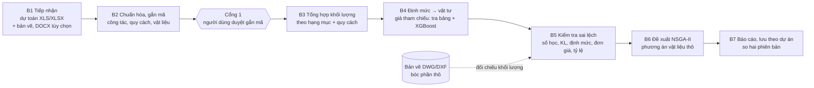

# Luồng chính: dự toán → tổng hợp → định mức, đơn giá → sai lệch → tối ưu (chốt 05/11/2026)

Trọng tâm đề tài (người dùng chốt 05/11/2026): **tổng hợp khối lượng theo hạng mục**, **tra cứu đơn giá, định mức để so sánh
lựa chọn**, **kiểm tra, phát hiện sai lệch khối lượng và chi phí**. Bóc tách bản vẽ là nguồn đối chiếu tùy chọn, không phải
trục chính. XGBoost dùng cho giá tham chiếu; NSGA-II dùng cho đề xuất lựa chọn vật liệu thô. Phạm vi: phần thô nhà ở riêng lẻ.

## 1. Luồng

Thứ tự các bước do mã cố định (quy tắc Agent). Thiếu số thì để trống kèm lý do, không điền mặc định (Quy ước B7). Mọi dòng
giữ nguồn: file, sheet, dòng Excel.

| Bước | Đầu vào | Mã (có / cần làm) | Đầu ra | Hiện trạng |
|---|---|---|---|---|
| B1 Tiếp nhận | file dự toán; bản vẽ, DOCX tùy chọn | `rough/estimate_reader.py`, `drawing/ingest.py` | bảng công tác, bảng vật tư chuẩn + nguồn dòng | ✅ đọc 5/6 file thật; 🔄 KD07 có đường đọc riêng trong `api/document_candidates.py` → gộp (DT01) |
| B2 Chuẩn hóa | bảng chuẩn | `facts/estimate.py` + `data/rules/cong_tac_du_toan.csv` (mã công tác, AI tùy chọn); `estimate_check.tag_materials` (mã vật liệu) | mã công tác, cấu kiện, **quy cách** (mác bê tông/vữa, phương án tường, dày trát), mã vật liệu; mỗi gắn có nguồn: quy tắc / AI / người dùng | 🔄 hai bộ gắn mã song song; quy cách chưa đọc từ tên (DT01) |
| Cổng 1 | các dòng tự gắn | trang `/kiem-tra-sai-lech` | gắn mã đã duyệt | ⬜ (DT02) |
| B3 Tổng hợp | công tác đã gắn mã | `rough/quantity_summary.py` (khóa gộp theo quy cách), `WORK_STAGE` | khối lượng theo giai đoạn (đất móng, khung, tường, chống thấm) × công tác × quy cách | ⬜ chưa áp cho dự toán (DT03) |
| B4 Định mức, giá | tổng hợp + danh mục | `rough/materials.materials_for_works`, `catalog/pricing`, `predict/` | vật tư dự kiến; giá tham chiếu theo **ngày + tỉnh lập dự toán** (tra bảng gần nhất và XGBoost, có khoảng) | 🔄 định mức có; giá chỉ so giá hiện hành (DT05) |
| B5 Sai lệch | B3, B4, bảng vật tư dự toán, bóc bản vẽ (tùy chọn) | `rough/estimate_check.py`, `rough/checks.py` (`khoang_hop_ly`) | danh sách phát hiện: loại, mức (lỗi / cảnh báo / thông tin), chênh, nguồn dòng | ✅ 4 loại; ⬜ tỷ lệ hợp lý, mức phát hiện (DT03), đo độ chính xác (DT04) |
| B6 Đề xuất | vật tư + giá + ràng buộc | `optimize/problem.py`, `rough/boq.export_for_optimizer` | tập Pareto phương án vật liệu thô (chi phí, thời gian cung ứng, U) | ⬜ NSGA-II chỉ cho tường (DT06) |
| B7 Báo cáo | mọi bước | `estimate_check.check_workbook`, `takeoff_results` | Excel, trang, lịch sử theo dự án, so hai phiên bản | 🔄 Excel có; chưa lưu (DT07) |

## 2. Sprint DT01–DT07

Mỗi sprint ~1 tuần. Tiêu chí chung (như SPRINTS.md): test mới đạt, `pytest` toàn bộ đạt, `check_data.py` 0 lỗi nếu đụng
`data/`, một dòng `NHAT_KY.md`. Không đổi lược đồ 20 bảng nếu chưa hỏi.

### DT01 Một bộ đọc, một bộ gắn mã, đọc quy cách từ tên — phụ thuộc: không
- Gộp: `estimate_check.classify` (regex viết cứng) thay bằng quy tắc `cong_tac_du_toan.csv` của `facts/estimate.py`;
  `document_candidates` (KD07) đọc XLS qua `estimate_reader`. Một nơi đọc, một nơi gắn mã.
- Quy cách từ tên công tác, quy tắc vào CSV mới `data/rules/quy_cach_du_toan.csv` (không viết cứng): mác bê tông
  ("M200", "B15"), mác vữa ("vữa M75"), phương án tường ("gạch ống 8x8x19" → `wall_system_id`), dày trát ("dày 1,5cm").
  Dòng mang quy cách riêng, không dùng một `ProjectParams` chung cho cả dự toán.
- Chốt mã xi măng PC40 (XM03) / PCB40 (XM02) trong `material_aliases` để vật tư dự toán và định mức cùng mã.
- **Xong khi:** bộ 46 và banve1 có số định mức cho xi măng, cát, đá, gạch, vữa (xây + trát + bê tông); xi măng bộ 46
  không còn lệch +87 % do thiếu công tác; test cho từng mẫu quy cách.

### DT02 Cổng duyệt gắn mã — phụ thuộc: DT01
- Trang `/kiem-tra-sai-lech`: bảng dòng tự gắn (mã công tác, cấu kiện, quy cách, mã vật liệu) sửa được, chạy lại kiểm tra.
  Dòng chưa duyệt vẫn chạy nhưng kết luận ghi "tự gắn".
- Lưu bản duyệt theo hash file dự toán (cùng cách cache KD01); sửa tay được đề xuất thành quy tắc CSV qua hàng chờ KD06.
- **Xong khi:** sửa một mã trên trang → kết quả đổi; mở lại cùng file giữ bản duyệt; test API.

### DT03 Tổng hợp theo hạng mục và mức phát hiện — phụ thuộc: DT01
- Bảng tổng hợp khối lượng dự toán theo giai đoạn × công tác × quy cách (dùng khóa gộp của `quantity_summary`), có cột
  hệ thống khi có bóc bản vẽ.
- Thêm kiểm tra tỷ lệ hợp lý (`khoang_hop_ly.csv`: bê tông, thép, khối xây / m² sàn) cho dự toán.
- Mỗi phát hiện có `muc` (lỗi: số học; cảnh báo: lệch quá ngưỡng; thông tin: chưa so được) và ngưỡng riêng từng loại
  trong CSV quy tắc, không một ngưỡng chung.
- **Xong khi:** trang có tab "Tổng hợp theo hạng mục"; Excel thêm sheet; test gộp quy cách.

### DT04 Đo độ chính xác phát hiện — phụ thuộc: DT01 (DT03 nên có)
- `scripts/evaluate_estimate_check.py`: cài lỗi có kiểm soát vào dự toán thật (khối lượng ±5/10/20/30 %, đơn giá ±,
  thành tiền sai, bỏ sót / nhân đôi công tác, đổi đơn vị 100m3 ↔ m3), seed cố định; đo precision / recall / F1 theo loại
  và theo cỡ lỗi; so với mốc "không kiểm tra" và "chỉ số học".
- Chia build / test theo `cases.csv`; báo cáo cuối chạy một lần trên test.
- **Xong khi:** `reports/estimate_check/` có bảng số theo loại lỗi; ghi rõ dữ liệu ACTUAL hay cài lỗi.

### DT05 Giá tham chiếu theo thời điểm (XGBoost) — phụ thuộc: dữ liệu giá thật nhiều kỳ ⏸
- Đọc ngày lập và tỉnh của dự toán (tiêu đề sheet, hoặc người dùng nhập). Tham chiếu = (a) tra bảng giá gần nhất trước
  ngày lập, (b) XGBoost dự đoán tại ngày + tỉnh, kèm khoảng (phân vị hoặc sai số trên tập kiểm định).
- Đơn giá ngoài khoảng → "bất thường"; luôn hiện song song (a) và (b) (quy tắc "luôn so với mốc tra bảng").
- Dữ liệu: công bố giá Sở XD nhiều kỳ → `price_records` (`import_price_bulletin.py`). Không báo cáo số từ SYNTHETIC/SAMPLE.
- **Xong khi:** bộ 46 (2016) so với giá 2016 chứ không phải 2026; bảng so XGBoost vs tra bảng trên tập test theo thời gian.

### DT06 Đề xuất vật liệu thô bằng NSGA-II — phụ thuộc: DT01, DT05 (giá)
- Mục tiêu, ràng buộc và quyền quyết định theo từng đối tượng: [MUC_TIEU_TOI_UU_THEO_DOI_TUONG.md](MUC_TIEU_TOI_UU_THEO_DOI_TUONG.md)
  (hệ thống lọc và tính, AI chỉ đề xuất, người dùng chốt).
- Mở rộng không gian quyết định ngoài tường: cách cấp bê tông (trộn tại chỗ ↔ thương phẩm, **giữ mác thiết kế**), hãng và
  nhà cung cấp thép, xi măng, cát, đá, gạch; đầu vào từ `export_for_optimizer` dựng trên dự toán đã duyệt.
- Tường: NSGA-II (chi phí, U, kg/m²). Vật tư khác: phân bổ đại lý (tiền giao tận nơi, số đại lý); ngày giao là ràng buộc theo giai đoạn.
- Từ dòng lệch giá / định mức trên trang → "Xem phương án" → 3–5 phương án có nhãn, người dùng bấm Áp dụng.
- **Xong khi:** chạy trên bộ 46 ra ≥ 1 phương án khả thi với nguồn giá ghi rõ; vét cạn khớp NSGA-II trên bài nhỏ (test).

### DT07 Lưu, lịch sử, so hai phiên bản — phụ thuộc: DT02
- Lưu kết quả kiểm tra theo dự án (bảng hiện có, `kind = "estimate_check"`, không thêm bảng nếu chưa hỏi).
- So hai file dự toán (lập ↔ điều chỉnh, dự toán ↔ quyết toán): dòng thêm / bớt / đổi khối lượng, đổi đơn giá.
- **Xong khi:** trang dự án có lịch sử kiểm tra; test so hai phiên bản.

Thứ tự đề xuất: **DT01 → DT02 + DT03 (song song, khác file) → DT04** (có số cho báo cáo) **→ DT05 → DT06 → DT07**.
DT05 phụ thuộc dữ liệu giá thật: bắt đầu thu thập công bố giá nhiều kỳ ngay từ DT01.
