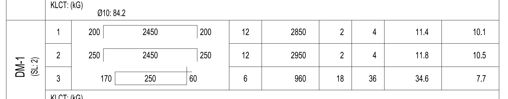
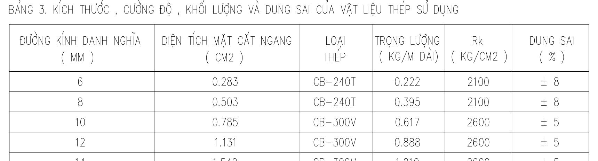

# VN002 — đối chiếu một hàng thép DM-1

Ngày 04/11/2026. Kiểm nội bộ theo quyền chủ đồ án đã xác nhận tại chat 00. Đây là đối chiếu một hàng bảng thống kê, chưa phải nghiệm thu một dầm vật lý hoặc toàn bể.

01 đã đọc [khóa cặp của 06](../data20_06/PAIR_LOCK.md) và [bằng chứng của 07](../data20_07/ONE_ELEMENT_TRACE.md), mở ảnh nguồn và hai ảnh trích, tính lại bằng Decimal và đối chiếu hash hai DXF/PDF cùng header đơn vị.

## Nguồn đã khóa

| Vai trò | Tệp trong repo | SHA-256 |
|---|---|---|
| KT | data/drawings/build/nha_sang_hai_duong_4x15_kien_truc.dxf | 719ea17b22b856bb31363fbfc9bf218f312112958e9de4f6638e2ede1f1cf8d6 |
| KC | data/drawings/build/nha_sang_hai_duong_4x15_ket_cau.dxf | 22cda9103ace1a6c0826805836f309a97bef71c03dc27d3508efdb56fe0ec19c |
| PDF KC | data/drawings/raw_20261103/VN002_nha_pho_4_tang_4x15/HỒ SƠ KẾT CẤU.pdf | 4b6ca4f97e80b85ae4d1df555f13ad1b531c8243f52f300ec34d436357060344 |

KT có 17.232.252 byte, HEADER/$INSUNITS = 4 (mm). KC có 15.295.031 byte, $INSUNITS = 0 (chưa khai báo). Bảng thống kê đang xét tự ghi đơn vị mm, m và kg; không coi toàn bộ hình học KC mặc nhiên là mm.

Hash xác định nội dung byte, không phải số revision thiết kế. Revision còn chưa xác định; cặp KT/KC hiện liên kết theo manifest, chưa được xác minh cùng revision. Quyền kiểm nội bộ đã được cho phép; quyền huấn luyện và phân phối lại chưa được xác nhận.

## Vị trí tìm lại và từng đầu vào

**PDF trang 18, bản KC-01-12, bảng “Thép bể nước” bên phải, nhóm DM-1 (SL:2), STT 1.** Đây không phải bảng bể phốt bên trái.

Trong DXF KC: INSERT `1173553`, block `TK_9`, layer `TEXT_TK`, tọa độ chèn x = −1345152,255989423; y = −1068252,078578262. Tỷ lệ chèn block 80 là tỷ lệ biểu diễn bảng, không nhân vào số kích thước ghi trong ô. Tọa độ từng ATTRIB có trong JSON của 07.

| Đại lượng | Giá trị nguồn | Locator CAD |
|---|---|---|
| Ba đoạn một thanh | 200 + 2450 + 200 mm | ATTRIB 1173555 / 1173556 / 1173557 dưới INSERT 1173553 |
| Chiều dài triển khai ghi bảng | 2850 mm | 1173559 / DAI |
| Đường kính | Ø12 mm | 1173558 / DK |
| Số thanh | 2 thanh/cấu kiện; 4 thanh toàn nhóm | 117355A / SL1; 117355B / SLA. Nhãn DM-1 và SL2: TEXT 1173581 / 1173582 |
| Đơn trọng | 0,888 kg/m | PDF trang 3, KC-00, bảng 3, dòng Ø12; TEXT 10FFADB tại x = −1730268,781144352; y = −1031517,590586386 |
| Giá trị in để đối chiếu | Tổng dài 11,4 m; khối lượng 10,1 kg | 117355C / DT; 117355D / TL |

## Công thức và kết quả

- Chiều dài một thanh: `(200 + 2450 + 200) / 1000 = 2,850 m`.
- Số thanh toàn nhóm: `2 thanh/cấu kiện × 2 cấu kiện = 4 thanh`.
- Tổng chiều dài: `4 × 2,850 = 11,4 m`.
- Khối lượng: `11,4 × 0,888 = 10,1232 kg`; làm tròn cuối đến 0,1 kg thành **10,1 kg**, khớp ô in của hàng này.

Không nhân số lượng cấu kiện 2 thêm lần nữa sau khi đã dùng 4 thanh toàn nhóm. Đơn trọng lấy từ chính hồ sơ, không thay bằng hệ số bên ngoài. 01 tính lại độc lập các phép toán từ số nguồn; SHA-256 của trace JSON là `6f461a4d56b78be6b7148959754e5f9555f93991d212eb64bf2e547d78095967`.

## Giới hạn còn mở

Chưa xác định tầng, trục và hai dầm vật lý; chưa chứng minh liên kết riêng hàng này sang kiến trúc. Chiều dài là các số trong bảng, chưa đo độc lập theo đường tim, bán kính uốn hoặc lớp bảo vệ. PDF và CAD cùng một thiết kế không phải hai đáp án thiết kế độc lập.

Tổng Ø12 của bể vẫn có xung đột 36,9 kg với các tổng con. Phép đối chiếu này không duyệt toàn DM-1 hoặc cả bể, không tạo lượng mua, giá hay hao hụt. Giữ `human_approval=false`, `verification_status=chua_kiem`; không sửa dữ liệu canonical, DB, kết quả 26 hoặc W5.
